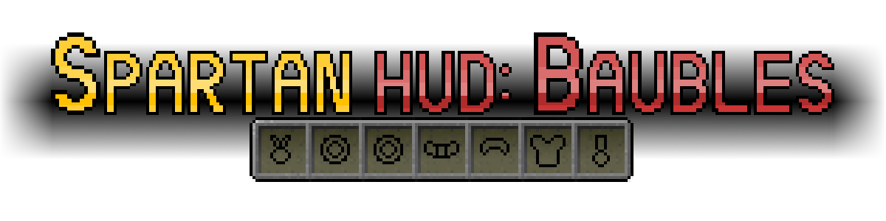
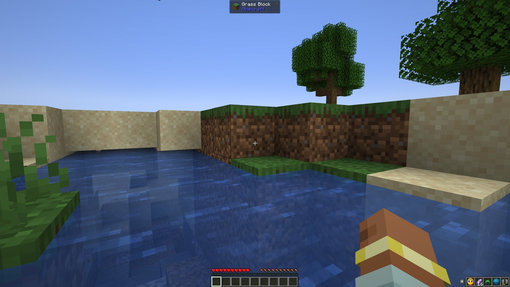
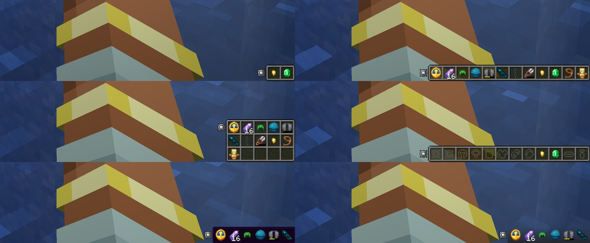
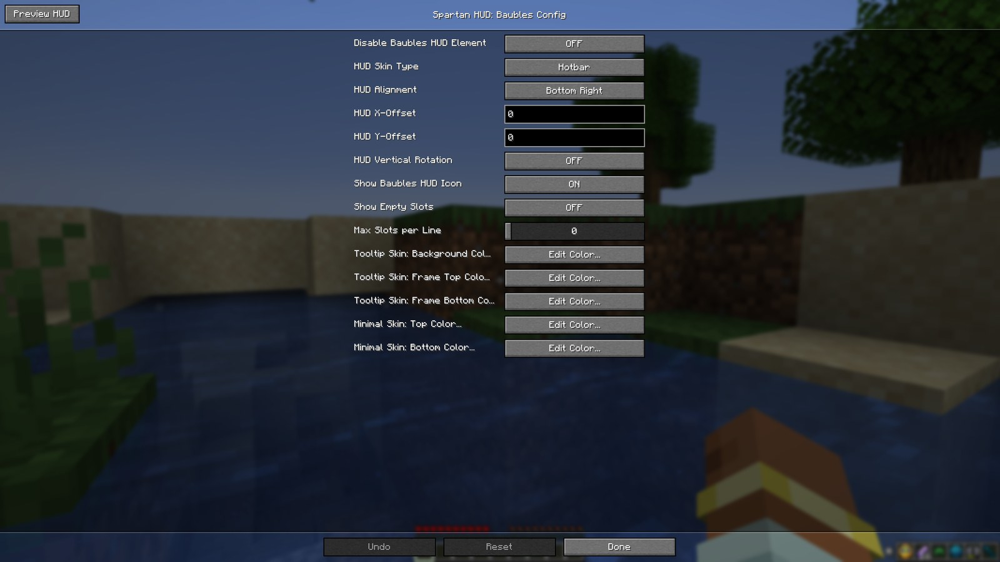
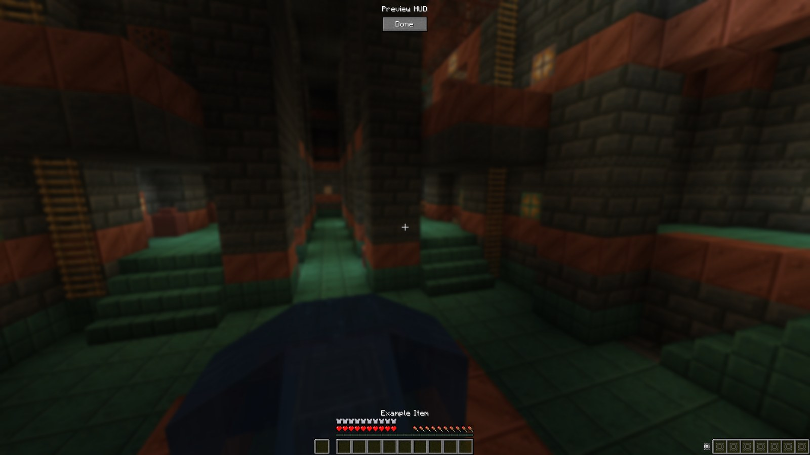

# Spartan HUD: Baubles — NeoForge 1.21.11

**See your Curios!**

An unofficial port of **Spartan HUD: Baubles** 1.0.0 by **ObliviousSpartan** from Minecraft 1.12.2 (Baubles) to
**NeoForge 1.21.11** with **Curios**, the 1.21 successor of Baubles. This is the 1.21.11 branch; the 1.21.1 version for
NeoForge (Curios) and Fabric (Trinkets) is on [`main`](../../tree/main). Trinkets has no 1.21.11 version, so 1.21.11 is
NeoForge only.

---

  

<b>🇬🇧 English — click to open</b>

## About the mod

A client-side HUD element that shows the Curios you have equipped, a made-from-scratch replacement for the old
Baubles HUD with more options.

- **Nine alignments**: any corner, the middle of any edge or the centre of the screen (the centre column keeps clear of
  the crosshair and the hotbar), plus **X and Y offsets** to move it away from other mods' HUD elements.
- **Horizontal or vertical**.
- **Four skins**: the vanilla **hotbar**, a **tooltip** frame and a **minimal** gradient (both with configurable
  colours), or **none** (just the items).
- **Any number of Curios**: Curios has no slot limit, so the hotbar skin stretches to any length and the slots continue
  in a new row (or column) when the screen is full or after `max_slots_per_line`.
- **Empty slots** with their Curios icons, if you like (`show_empty_slots`).
- **Config GUI** in the mods menu with a **Preview HUD** button: see your changes at once, in game or from the main
  menu (with a mock HUD there).
- Durability bars and stack counts, updated live; hidden with F1, in spectator mode and with `disable_hud`.
- **Languages**: English, Russian, Ukrainian, German, Spanish, Brazilian Portuguese (all but English are new machine
  translations checked by hand; corrections welcome).
- **For addons**: `RenderBaubleOnHUDEvent.Pre` / `.Post` fire around every Curio drawn on the HUD.

## Screenshots

  
  
  

## Installation

1. Install **NeoForge 21.11.48** or newer for Minecraft **1.21.11** and **[Curios](https://www.curseforge.com/minecraft/mc-mods/curios) 14.0.0+1.21.11** or newer.
2. Put `spartanhudbaubles-neoforge-1.0.0.3+1.21.11.jar` from the [releases](../../releases) into the `mods` folder of
   your **client**.

The mod is **client-side only**: servers do not need it (they need Curios for the accessories themselves). It does
nothing on a server if a modpack ships it there.

Settings: **Mods → Spartan HUD: Baubles → Config**, or `config/spartanhudbaubles-client.toml`.

| Option | Default | |
| --- | --- | --- |
| `disable_hud` | `false` | Turns the HUD element off |
| `skin_type` | `HOTBAR_STYLE` | `NONE`, `HOTBAR_STYLE`, `TOOLTIP_STYLE`, `MINIMAL` |
| `alignment` | `BOTTOM_RIGHT` | `TOP_LEFT` … `BOTTOM_RIGHT` (9) |
| `offset_x`, `offset_y` | `0` | −1000 … 1000 |
| `rotate_vertical` | `false` | Vertical instead of horizontal |
| `show_baubles_icon` | `true` | The Curios icon next to the element (not with skin `NONE`) |
| `show_empty_slots` | `false` | **New**: empty slots with their icons |
| `max_slots_per_line` | `0` | **New**: slots per row / column, `0` = as many as fit on the screen |
| `tooltip_*_colour`, `minimal_*_colour` | as 1.0.0 | `red`, `green`, `blue`, `alpha` 0–255 |

## What changed in the port

Everything of 1.0.0 is in the port; Baubles became Curios. The Curios are shown in the order of the Curios inventory;
slot types that Curios hides, disabled slots and cosmetic slots are left out. The Curios inventory button replaces the
Baubles icon. The Preview HUD has no lone **Done** button floating over the crosshair any more: it closes with a click anywhere or Escape, as the hint at its top says.

| Original issue | Fix |
| --- | --- |
| [#1](https://github.com/ObliviousSpartan/SpartanHUD-Baubles/issues/1) The hotbar skin disappears with more than 7 slots | The skin is built from pieces for any number of slots (1–7 look exactly as before), with extra rows when needed |
| [#1](https://github.com/ObliviousSpartan/SpartanHUD-Baubles/issues/1) Show empty slots | New option `show_empty_slots` |
| [#2](https://github.com/ObliviousSpartan/SpartanHUD-Baubles/issues/2) A ring that breaks stays on the HUD until the inventory is opened | Fixed: the HUD follows Curios' synced slots; tested on a dedicated server |
| Found in the code: an unknown value in the config file crashed the game | Values are validated and reset to their defaults |

Problems and fixes in detail

The hotbar skin with more than 7 slots (issue #1)

- **Problem**: with mods that add bauble slots, the background disappeared and the items floated on the screen.
- **Cause**: the original drew the skin from fixed pieces of `hud.png` for 1, 2, … 7 slots, and nothing for 8 or more.
- **Fix**: the skin is cut into a first slot, a middle slot that is repeated, and a last slot. For 1–7 slots the result
  is pixel-identical to the original (compared on the texture); more rows use the 7×7 grid that `hud.png` already had.

Broken Curios staying on the HUD (issue #2)

- **Problem**: a ring with durability that broke stayed on the HUD until the Baubles inventory was opened.
- **Cause**: the client did not learn about a stack that broke in its slot.
- **Fix**: Curios syncs stacks that change in place, and the HUD reads them every frame. The test scenes shrink a Curio
  to nothing on the server and check that it leaves the HUD within ticks, in singleplayer and on a dedicated server.

Crash on a wrong config value

- **Problem**: `skin_type = FOO` in the config file (a typo, an old file) crashed the game at start.
- **Cause**: the 1.12 code converted the text with `valueOf` without checking it.
- **Fix**: NeoForge's config validates every value: unknown ones are reset to the default, numbers clamped to their
  range. The stress test starts with such a file.

## Compatibility

Tested with Curios 14.0.0, JEI, and in a compatibility run with Sodium, Iris, Lithium, FerriteCore and Jade. Any mod adding Curios slots or items works. Accessories is not supported directly (it may work through its Curios
compatibility layer; not tested).

## Testing

- **Client scene** (`tools/scenetest.sh`): 84 checks — what the element collects and where it is for 1, 2, 7 and 12
  Curios, wrapped rows, empty slots, every skin, all 9 alignments horizontal and vertical, offsets, F1, spectator, live
  durability, a Curio breaking in its slot, the config GUI and the preview through real clicks, the saved file, the main
  menu preview, translations. That the element is really drawn is checked by comparing the frame with one drawn
  without it. Run on NeoForge 21.11.48 with Curios 14.0.0.
- **Stress** (`-Pscene=stress`): 13 checks — a broken config file at start, 74 Curios, 200 ticks of random changes,
  GUI scales 1–4 and an 854×480 window with every alignment,
  extreme offsets, one slot per line, leaving and rejoining the world.
- **Multiplayer** (`tools/nettest.sh`): a client on a dedicated server, Curios equipped on the server: 6 checks.
- **Release jar** on a real NeoForge **21.11.48** server, with and without Curios: starts, no errors.
- **Compatibility**: Sodium 0.8.14, Iris 1.10.8 with Complementary shaders, Lithium 0.21.4, FerriteCore 8.2.0,
  Jade 21.1.7, JEI 27.48: the client scene, 84/84.
- Details: [PORTLOG.md](PORTLOG.md).

## Source and credits

- Original mod and textures: **ObliviousSpartan** —
  [GitHub](https://github.com/ObliviousSpartan/SpartanHUD-Baubles),
  [CurseForge](https://www.curseforge.com/minecraft/mc-mods/spartan-hud-baubles). Credits of the original: Shivaxi for
  the ideas, the RLCraft modpack team for testing and feedback.
- Port to NeoForge 1.21.1 / 1.21.11 (Curios) and Fabric 1.21.1 (Trinkets): **Vladeezyy**.

## License

Copyright (c) 2026 Vladeezyy. This port is licensed under the **GNU LGPL-3.0-only** ([LICENSE](LICENSE); it refers to
the GPL-3.0 in [licenses/COPYING](licenses/COPYING)). The original Spartan HUD: Baubles is © ObliviousSpartan under the
Apache License 2.0, kept in [licenses/LICENSE-APACHE](licenses/LICENSE-APACHE).

Forks are welcome: they must stay open, under the same license, and credit the authors. Please download the mod only
from its official pages.

<b>🇷🇺 Русский — нажмите, чтобы открыть</b>

## О моде

Клиентский элемент HUD, который показывает надетые предметы Curios. Написан с нуля как замена старого Baubles HUD,
с дополнительными настройками.

- **Девять положений**: любой угол, середина любого края или центр экрана (центральная колонка не залезает на прицел и
  панель быстрого доступа), плюс **сдвиг по X и Y**, чтобы не перекрывать HUD других модов.
- **По горизонтали или по вертикали**.
- **Четыре оформления**: ванильная **панель быстрого доступа**, рамка **подсказки** и **минимальный** градиент (оба с
  настраиваемыми цветами) или **без фона** (только предметы).
- **Сколько угодно предметов**: в Curios нет предела числа ячеек, поэтому фон-хотбар растягивается на любую длину, а
  ячейки переносятся на новую строку (или в новый столбец), когда экран кончился или после `max_slots_per_line`.
- **Пустые ячейки** со значками Curios, если нужно (`show_empty_slots`).
- **Окно настроек** в списке модов с кнопкой **Preview HUD**: изменения видны сразу, в игре или из главного меню (там
  с макетом HUD).
- Полоски прочности и число предметов обновляются на лету; HUD скрывается по F1, в режиме наблюдателя и через
  `disable_hud`.
- **Языки**: английский, русский, украинский, немецкий, испанский, бразильский португальский (все, кроме английского, —
  новые машинные переводы, проверенные вручную; исправления приветствуются).
- **Для аддонов**: события `RenderBaubleOnHUDEvent.Pre` / `.Post` вокруг каждого предмета на HUD.

## Скриншоты

См. английский раздел выше: [HUD](docs/images/hud.jpg), [оформления и раскладки](docs/images/skins.jpg),
[настройки](docs/images/config.jpg), [предпросмотр из меню](docs/images/preview_menu.jpg).

## Установка

Это ветка 1.21.11; версия 1.21.1 для NeoForge (Curios) и Fabric (Trinkets) — в [`main`](../../tree/main). У Trinkets нет
версии под 1.21.11, поэтому 1.21.11 — только NeoForge.

1. Установите **NeoForge 21.11.48** или новее для Minecraft **1.21.11** и **[Curios](https://www.curseforge.com/minecraft/mc-mods/curios) 14.0.0+1.21.11** или новее.
2. Положите `spartanhudbaubles-neoforge-1.0.0.3+1.21.11.jar` из [релизов](../../releases) в папку `mods` **клиента**.

Мод **только клиентский**: серверу он не нужен (серверу нужен Curios для самих предметов). Если сборка кладёт его на
сервер, он там ничего не делает.

Настройки: **Моды → Spartan HUD: Baubles → Настроить** или `config/spartanhudbaubles-client.toml`. Параметры — в
таблице английского раздела; новые: `show_empty_slots` (пустые ячейки) и `max_slots_per_line` (ячеек в ряду, `0` —
сколько влезает на экран).

## Что изменилось при порте

Всё из 1.0.0 перенесено; Baubles заменён на Curios. Предметы идут в порядке инвентаря Curios; скрытые Curios типы
ячеек, отключённые и косметические ячейки не показываются. Вместо значка Baubles — кнопка инвентаря Curios. Вместо одинокой кнопки
**Done** над прицелом предпросмотр закрывается щелчком в любом месте или Esc, о чём говорит подсказка вверху.

| Issue оригинала | Исправление |
| --- | --- |
| [#1](https://github.com/ObliviousSpartan/SpartanHUD-Baubles/issues/1) Фон-хотбар пропадает при больше чем 7 ячейках | Фон собирается из кусков на любое число ячеек (1–7 выглядят точно как раньше), при нужде — в несколько рядов |
| [#1](https://github.com/ObliviousSpartan/SpartanHUD-Baubles/issues/1) Показывать пустые ячейки | Новый параметр `show_empty_slots` |
| [#2](https://github.com/ObliviousSpartan/SpartanHUD-Baubles/issues/2) Сломавшееся кольцо висит на HUD, пока не откроешь инвентарь | Исправлено: HUD следит за синхронизированными ячейками Curios; проверено на выделенном сервере |
| Найдено в коде: неизвестное значение в файле настроек роняло игру | Значения проверяются и сбрасываются к умолчанию |

Проблемы и исправления подробно

Фон-хотбар при больше чем 7 ячейках (issue #1)

- **Проблема**: с модами, добавляющими ячейки, фон пропадал, и предметы висели в воздухе.
- **Причина**: оригинал рисовал фон из готовых кусков `hud.png` для 1, 2, … 7 ячеек и ничего для 8 и больше.
- **Исправление**: фон режется на первую ячейку, повторяемую среднюю и последнюю. Для 1–7 ячеек результат совпадает
  с оригиналом пиксель в пиксель (сверено по текстуре); несколько рядов берутся из сетки 7×7, которая уже была в
  `hud.png`.

Сломанные предметы остаются на HUD (issue #2)

- **Проблема**: кольцо с прочностью ломалось, но оставалось на HUD, пока не открыть инвентарь Baubles.
- **Причина**: клиент не узнавал о предмете, сломавшемся прямо в ячейке.
- **Исправление**: Curios синхронизирует предметы, изменившиеся на месте, а HUD читает их каждый кадр. Тестовые сцены
  уменьшают предмет до нуля на сервере и проверяют, что он пропадает с HUD за несколько тиков — в одиночной игре и на
  выделенном сервере.

Вылет из-за неверного значения в настройках

- **Проблема**: `skin_type = FOO` в файле настроек (опечатка, старый файл) ронял игру при запуске.
- **Причина**: код 1.12 превращал текст в значение через `valueOf` без проверки.
- **Исправление**: конфиг NeoForge проверяет каждое значение: неизвестные сбрасываются к умолчанию, числа обрезаются по
  диапазону. Стресс-тест начинается с такого файла.

## Совместимость

Проверено с Curios 14.0.0, JEI и в прогоне совместимости с Sodium, Iris, Lithium, FerriteCore и Jade.
Работает с любыми модами, добавляющими ячейки или предметы Curios. Accessories напрямую не поддерживается (может
работать через его слой совместимости с Curios; не проверялось).

## Тестирование

- **Клиентская сцена** (`tools/scenetest.sh`): 84 проверки — что элемент собирает и где стоит при 1, 2, 7 и 12
  предметах, перенос рядов, пустые ячейки, все оформления, все 9 положений по горизонтали и вертикали, сдвиги, F1,
  наблюдатель, прочность на лету, поломка предмета в ячейке, окно настроек и предпросмотр настоящими кликами, сохранение
  файла, предпросмотр из главного меню, переводы. Что элемент действительно нарисован, проверяется сравнением кадра с
  кадром без него. Прогнано на NeoForge 21.11.48 с Curios 14.0.0.
- **Стресс** (`-Pscene=stress`): 13 проверок — испорченный файл настроек при запуске, 74 предмета, 200 тиков случайных
  изменений, масштабы GUI 1–4 и окно 854×480 со всеми положениями, крайние
  сдвиги, одна ячейка в ряду, выход и повторный вход в мир.
- **Сетевая игра** (`tools/nettest.sh`): клиент на выделенном сервере, предметы надеваются на сервере: 6 проверок.
- **Release jar** на настоящем сервере NeoForge **21.11.48**, с Curios и без: запускается без ошибок.
- **Совместимость**: Sodium 0.8.14, Iris 1.10.8 с шейдерами Complementary, Lithium 0.21.4, FerriteCore 8.2.0,
  Jade 21.1.7, JEI 27.48: клиентская сцена 84/84.
- Подробности: [PORTLOG.md](PORTLOG.md).

## Исходники и авторы

- Оригинальный мод и текстуры: **ObliviousSpartan** —
  [GitHub](https://github.com/ObliviousSpartan/SpartanHUD-Baubles),
  [CurseForge](https://www.curseforge.com/minecraft/mc-mods/spartan-hud-baubles). Благодарности оригинала: Shivaxi за
  идеи, команде сборки RLCraft за тестирование.
- Порт на NeoForge 1.21.1 / 1.21.11 (Curios) и Fabric 1.21.1 (Trinkets): **Vladeezyy**.

## Лицензия

Copyright (c) 2026 Vladeezyy. Порт распространяется под **GNU LGPL-3.0-only** ([LICENSE](LICENSE); она ссылается на
GPL-3.0 в [licenses/COPYING](licenses/COPYING)). Оригинальный Spartan HUD: Baubles © ObliviousSpartan под лицензией
Apache 2.0, её текст сохранён в [licenses/LICENSE-APACHE](licenses/LICENSE-APACHE).

Форки приветствуются: они должны оставаться открытыми, под той же лицензией и с указанием авторов. Пожалуйста,
скачивайте мод только с официальных страниц.

